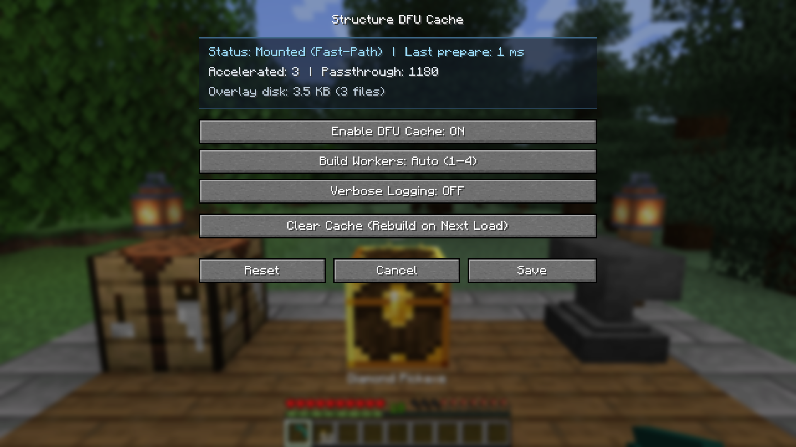

# Structure DFU Cache

<p align="center">
  
</p>

**Speeds up world loading and `/reload` in modpacks by caching upgraded structure templates on disk.**

Many structure and dungeon mods ship `.nbt` structure files saved on older Minecraft versions, forcing vanilla DataFixerUpper (DFU) to re-upgrade the exact same templates every time you open a world or run `/reload`. **Structure DFU Cache** upgrades outdated structure templates once into a local `cache/structure_dfu_cache/` folder and serves the upgraded files directly on future launches.



## Why Use It

- **Upgrade once, skip repeat work**: Automatically detects modpack or datapack changes; when nothing changed, warm world loads validate the cache in a few milliseconds instead of re-converting thousands of structure files.
- **Only touches outdated templates**: Structure files that already match the current Minecraft version (or exceed safe size limits) are left untouched without duplicating disk space.
- **RAM-friendly on heavy packs**: Automatically throttles background worker threads when your client or server runs with tight heap headroom (`-Xmx <= 6.8G`) so initial cache builds don't spike memory.
- **Built-in status screen, OP commands & optional chat notice**: Check prepare time, upgraded structure counts, and cache disk usage — or trigger a clean rebuild — from the Mod Menu / Forge / NeoForge config screen or via `/structuredfucache status` and `/structuredfucache clear` (OPs only). Chat stays quiet by default (`notifyInChat = false`), with an optional toggle to send a single status notice to joining OPs or the singleplayer host.
- **Safe to add or remove anytime**: Works alongside **Lithium**, **ModernFix**, **FerriteCore**, **C2ME**, and **LazyDFU**, and never modifies your world saves.


## Configuration

Edit in-game or in `config/structure_dfu_cache.toml`:

```toml
# Master switch. Set false to bypass the cache and load raw mod/datapack structures directly.
enabled = true

# Max background threads during initial/incremental cache builds (0 = automatic 1..4 based on free heap).
maxWorkers = 0

# Log detailed cache build diagnostics at INFO level.
verboseLogging = false

# Send a single concise cache status notice in chat to joining OPs / singleplayer host (off by default).
notifyInChat = false
```
